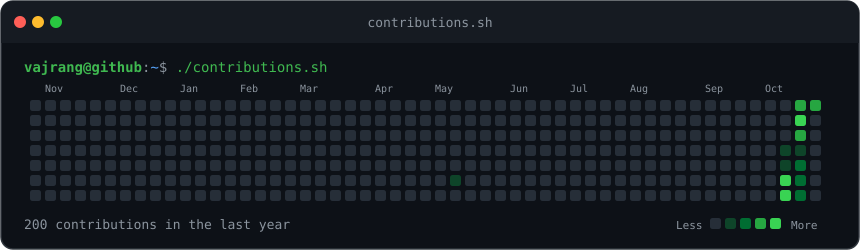
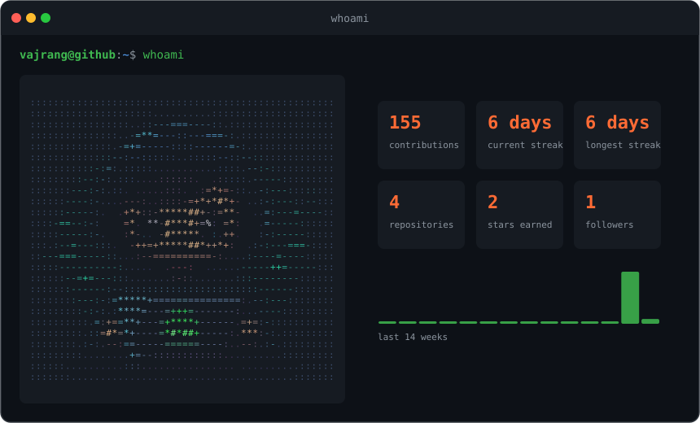
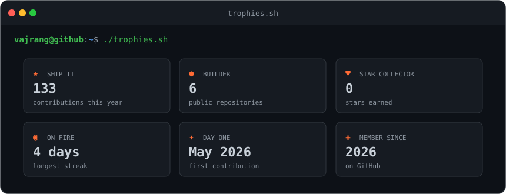
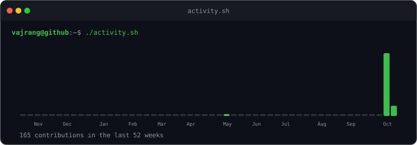

  

  
  
  

<h3><code>vajrang@github ~ $ ./contributions.sh</code></h3>

 
 

<h3><code>vajrang@github ~ $ whoami</code></h3>

## Achievements

  
  

<h3><code>vajrang@github ~ $ ./about.sh</code></h3>

- CS student at **Polaris School of Technology**, Bengaluru
- Building **Sonara** — a free, open-source music player for Mac
- Contributing to **Jenkins** through my college's Open Source OJT track
- Working toward **GSoC 2027**
- Learning in public: **JavaScript**, **Python**, **Git**

<h3><code>vajrang@github ~ $ ./stack.sh</code></h3>

<h3><code>vajrang@github ~ $ ./projects.sh</code></h3>

<h3><code>vajrang@github ~ $ ./trophies.sh</code></h3>

 
 

<h3><code>vajrang@github ~ $ ./activity.sh</code></h3>

 
 

<h3><code>vajrang@github ~ $ ./links.sh</code></h3>

